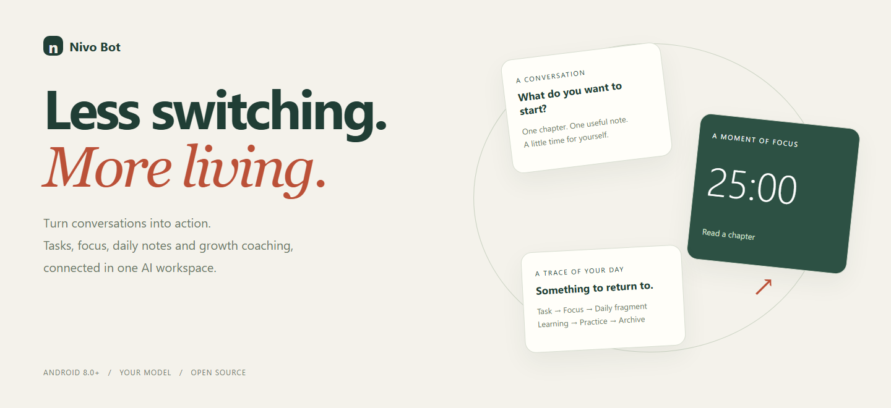
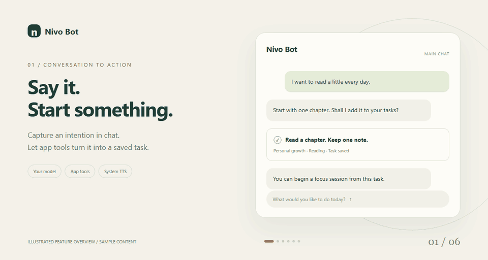
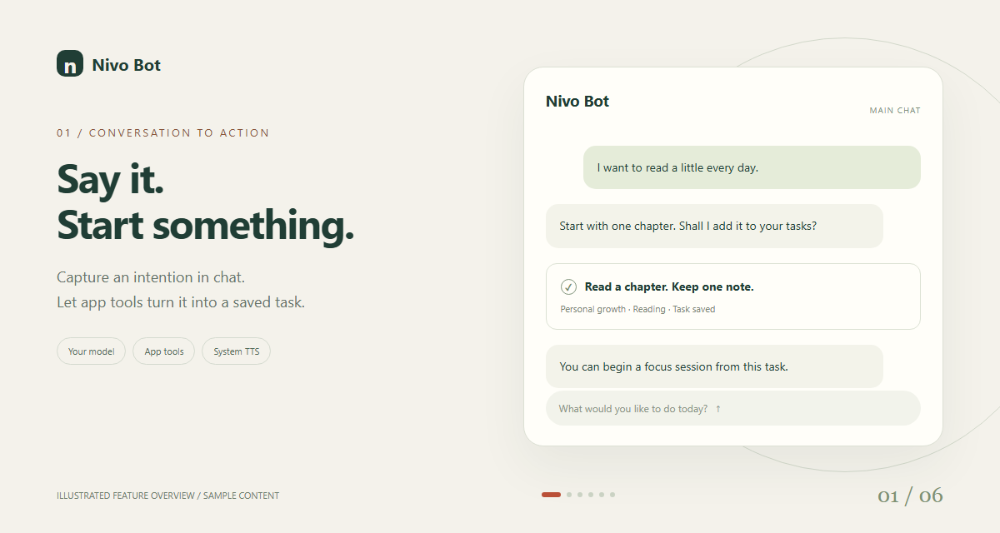
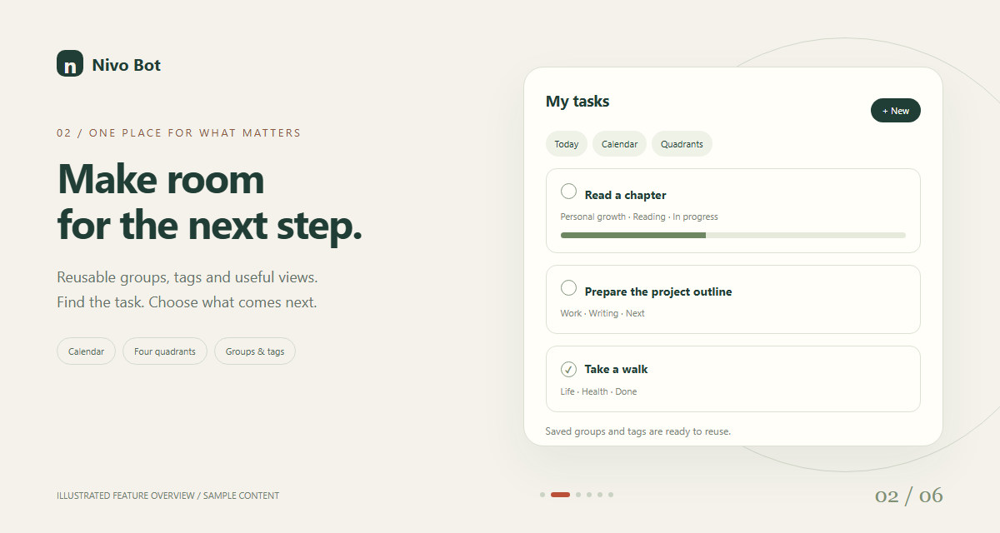
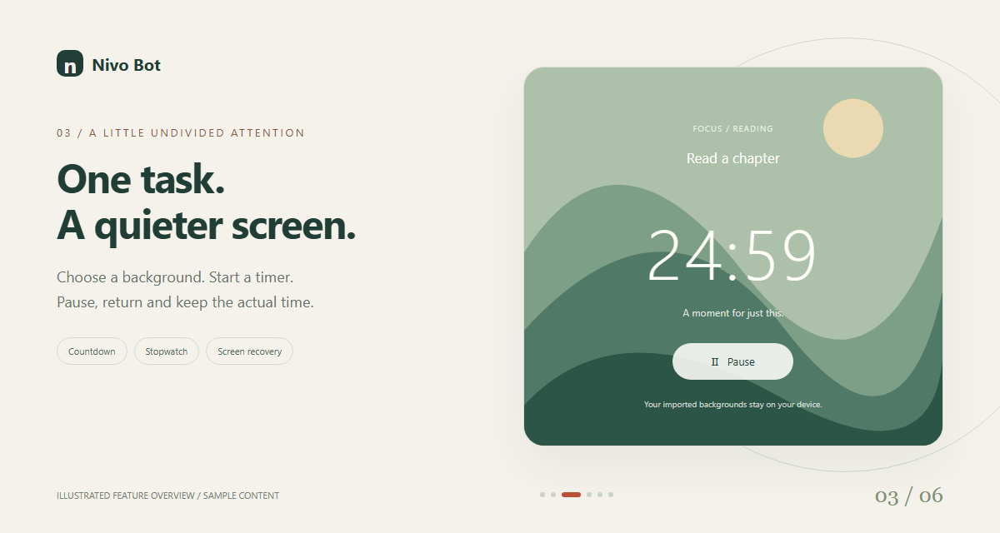
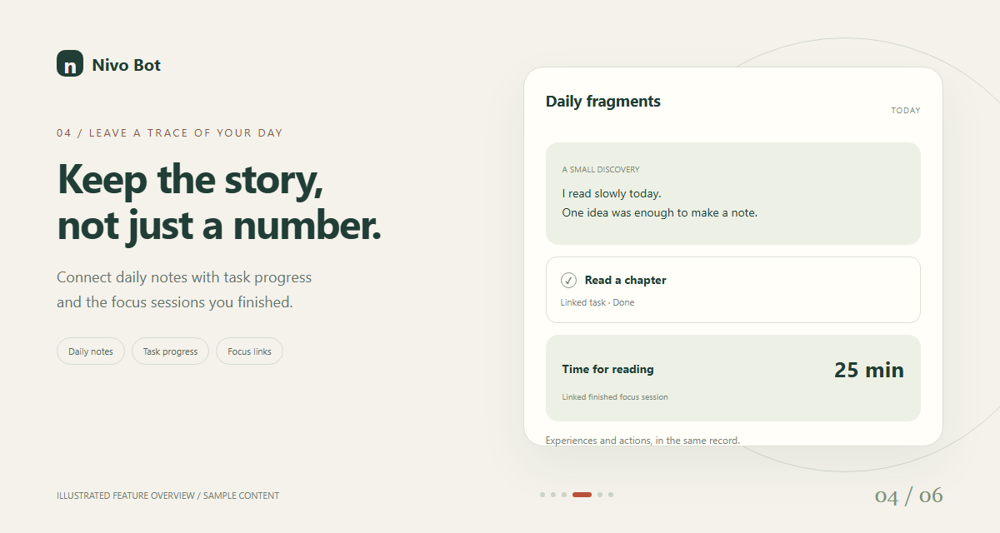
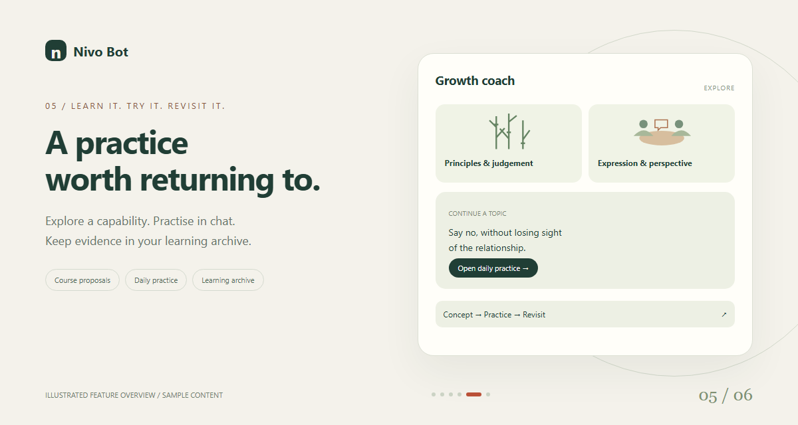
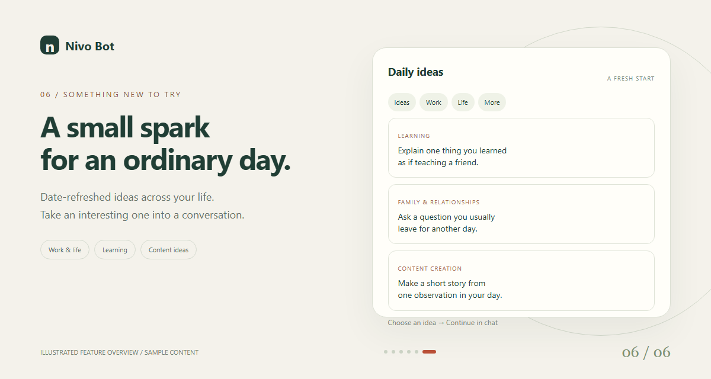

# Nivo Bot

<p align="center">
  <a href="https://nivo.8666886.xyz/"></a>
</p>

**AI chat, tasks, focus, daily fragments and growth coaching in one Android workspace.**

<p align="center">
  <a href="README.md">English</a> |
  <a href="docs/readme/README_zh.md">简体中文</a> |
  <a href="docs/readme/README_zh-TW.md">繁體中文</a> |
  <a href="docs/readme/README_es.md">Español</a> |
  <a href="docs/readme/README_fr.md">Français</a> |
  <a href="docs/readme/README_id.md">Bahasa Indonesia</a> |
  <a href="docs/readme/README_ja.md">日本語</a> |
  <a href="docs/readme/README_ko.md">한국어</a> |
  <a href="docs/readme/README_ru.md">Русский</a> |
  <a href="docs/readme/README_vi.md">Tiếng Việt</a>
</p>

<p align="center">
  <a href="LICENSE"></a>
  
  <a href="docs/releases/v2.0.0.md"></a>
  <br>
  <a href="https://nivo.8666886.xyz/">Website</a> · <a href="https://github.com/sherlockerX/Nicholasx/issues">Issues</a> · <a href="OPEN_SOURCE.md">Contribute</a>
</p>

Nivo Bot is an AI workspace for everyday life. Start with a conversation, turn the next step into a task, give it focused time and keep the experience in a record you can return to.

Free, open source and non-profit. Bring your own model provider; its requests may have a cost. Android system TTS reads replies using your phone's voice engine.

## Take a look around

<p align="center">
  <a href="docs/media/readme/feature-tour.gif"></a>
</p>

An illustrated feature tour, with sample content. The GIF slides horizontally through six modules; select a still below to enlarge it. These are explanatory visuals, not device screenshots.

<table>
<tr>
<td width="33%" align="center"><a href="docs/media/readme/chat.png"></a><br><sub>AI chat</sub></td>
<td width="33%" align="center"><a href="docs/media/readme/tasks.png"></a><br><sub>Tasks</sub></td>
<td width="33%" align="center"><a href="docs/media/readme/focus.png"></a><br><sub>Focus</sub></td>
</tr>
<tr>
<td width="33%" align="center"><a href="docs/media/readme/fragments.png"></a><br><sub>Daily fragments</sub></td>
<td width="33%" align="center"><a href="docs/media/readme/coach.png"></a><br><sub>Coach</sub></td>
<td width="33%" align="center"><a href="docs/media/readme/ideas.png"></a><br><sub>Daily ideas</sub></td>
</tr>
</table>

## What you can do

| Area | Android features |
|---|---|
| AI chat | Configure model providers, use integrated task and focus tools, and listen to replies with Android system text-to-speech. |
| Ideas | Browse date-refreshed suggestions for work, life, learning, family and relationships, content creation and more. |
| Tasks | Reuse saved groups and tags; switch between calendar, four quadrants, groups and status views; review completed-task tag proportions. |
| Focus | Run a countdown or stopwatch, link it to a task, pause and resume, and use a recoverable full-screen timer with locally imported backgrounds. |
| Daily fragments | Record daily experiences and attach task progress or completed focus sessions. |
| Coach | Explore capability areas, develop course proposals through AI chat, practise in Daily practice conversations and revisit your learning archive. |

Task charts count completed tasks by tag, not time spent. Focus statistics record actual elapsed time, and finishing a focus session does not automatically complete its task. Browsing a course does not mark it mastered.

## One intention, a connected day

For example, you want to read a little every day:

1. **Talk it through.** Ask AI to help make the goal concrete and create a reading task through the app tools.
2. **Give it a place.** Keep it in a saved group, reuse your tags and find it in the task view that works for you.
3. **Give it time.** Start a focus session linked to the task. Pick a background and use the full-screen timer.
4. **Keep the experience.** Link the finished session and task progress to a daily fragment, alongside what you noticed.
5. **Keep learning.** When a capability needs practice, develop a course proposal in chat, practise in Daily practice and revisit the Coach archive.

The connection is the feature: you can follow the same intention across conversation, action, time and reflection.

AI task changes are saved through app tools. A conversational reply alone is not a saved task, and AI completion requires the current user's explicit completion report. Focus durations come from the timer, not numbers invented by the model.

Learning, tasks, focus records and fragments use local storage with module-specific account and backup rules. Messages you send to a model are processed by the provider you configure. Review permissions and each module's backup coverage before migrating devices.

## Get started

| Resource | Link |
|---|---|
| Product website | [nivo.8666886.xyz](https://nivo.8666886.xyz/) |
| Android 8.0+, arm64 | [Nivo Bot v2.0.0 APK](https://nivo.8666886.xyz/downloads/Nivo-Bot-v2.0.0-arm64.apk) |
| Source corresponding to the APK | [v2.0.0 source bundle](https://nivo.8666886.xyz/downloads/Nivo-Bot-v2.0.0-source.zip) |
| Download checksums | [SHA256SUMS.txt](https://nivo.8666886.xyz/downloads/SHA256SUMS.txt) |
| Release details | [Release notes](docs/releases/v2.0.0.md) · [Verification record](docs/releases/v2.0.0-verification.json) |

This release covers Android and the product website. Other platform source remains in the repository; it does not establish Nivo Bot releases or feature parity on those platforms.

The application ID remains `io.github.nanomuse.app`. Installations signed with an old Debug or upstream key normally cannot be updated with this release. Check backup and restore coverage before uninstalling anything; see the [version and signing guide](docs/android-development.md#nivo-bot的android版本与签名).

## Build from source

<details>
<summary>Development details</summary>

Clone with native dependency submodules:

```bash
git clone --recurse-submodules https://github.com/sherlockerX/Nicholasx.git
cd Nicholasx
```

Use JDK 21, Android SDK 36, NDK 27.2.12479018 and CMake 3.22.1. The repository includes Gradle Wrapper 8.11.1. Prepare native dependencies on Linux or WSL after configuring the toolchain:

```bash
bash scripts/android/build-natives.sh
```

On Windows PowerShell 7:

```powershell
$env:JAVA_HOME = 'C:\path\to\jdk21'
$env:ANDROID_HOME = 'C:\path\to\android-sdk'
./scripts/android/Build-Android.ps1 -Target Check
./scripts/android/Build-Android.ps1 -Target Debug
```

See the [Android development guide](docs/android-development.md) for native inputs, tests, outputs and release signing. Keep signing keys and credentials outside the repository. A cached local build does not prove a clean-machine build or real-device compatibility.

</details>

## Repository layout

<details>
<summary>Source layout</summary>

| Path | Contents |
|---|---|
| `android/src/android/` | Android app; Nivo additions live under `io.github.nanomuse.*`. |
| `site/` | Static product website and download metadata. |
| `docs/` | User guides, source map and release records. |
| `scripts/android/`, `scripts/release/` | Build, signing, source audit and packaging tools. |
| `android/src/ios/`, `harness/`, `nanomuse/`, `cloud/`, `web/` | Retained iOS, desktop, runtime, relay and web-console source with separate release and verification scopes. |

The Android tree retains its upstream structure, package identities and attribution. Read the [source map](docs/android-code-map.md) before changing module boundaries.

</details>

## Documentation

- [Open-source entry and contribution scope](OPEN_SOURCE.md)
- [Android user guide](docs/zh/android.md)
- [Android development and signing](docs/android-development.md)
- [Android source map](docs/android-code-map.md)
- [Website source and deployment](site/README.md)
- [Changelog](CHANGELOG.md)
- [Copyright and provenance](NOTICE) · [Third-party notices](THIRD_PARTY_NOTICES.md)

## Contributing

Report reproducible problems in [this repository's Issues](https://github.com/sherlockerX/Nicholasx/issues) and submit focused pull requests. Follow [OPEN_SOURCE.md](OPEN_SOURCE.md) and [CONTRIBUTING.md](CONTRIBUTING.md), including Conventional Commits, tests appropriate to the change and a DCO sign-off with `git commit -s`.

Preserve upstream copyright and license notices. Keep API keys, signing material and personal records out of issues and commits. OpenMinis retains its own contribution policy; accepting work in this fork does not change that policy.

## Maintainer

This Nivo Bot fork is maintained by <a href="https://github.com/sherlockerX">sherlockerX</a>. Report Nivo-specific issues here so they reach this fork's maintainer.

## License

[GPL-3.0-or-later](LICENSE), continuing the original open-source license. Preserve copyright and license notices and provide corresponding source when distributing binaries as required by the GPL. The software is provided without warranty; [NOTICE](NOTICE) and [THIRD_PARTY_NOTICES.md](THIRD_PARTY_NOTICES.md) record upstream and dependency terms.

## Acknowledgements

Nivo Bot is built on [nanoMuse](https://github.com/nano-muse/nanoMuse), whose personal-agent foundation, model and tool integrations, and architecture made this work possible. Thank you to nanoMuse, its maintainer <a href="https://github.com/lgy0404">Guangyi Liu (lgy0404)</a>, and its contributors. The phone foundation comes from [OpenMinis](https://github.com/OpenMinis/OpenMinis).

The retained contributor list below credits nanoMuse's upstream history. Full credits and historical milestones are in [the provenance archive](docs/archive/upstream-readme-en.md); dependency terms remain in [THIRD_PARTY_NOTICES.md](THIRD_PARTY_NOTICES.md). Nivo Bot is independently maintained.

<details>
<summary>Upstream contributors and provenance</summary>

<!-- contributors:start -->
<p>
<a href="https://github.com/cutey-none"></a>
<a href="https://github.com/Mola-maker"></a>
<a href="https://github.com/wsvn53"></a>
<a href="https://github.com/jiangkaiqi2005"></a>
<a href="https://github.com/hobostay"></a>
<a href="https://github.com/fenghaofenghao-ctrl"></a>
<a href="https://github.com/Yicheng-1218"></a>
<a href="https://github.com/PovedaAqui"></a>
<a href="https://github.com/Longfellow1"></a>
<a href="https://github.com/Battleplus"></a>
<a href="https://github.com/Ichiro786"></a>
<a href="https://github.com/aliabbas6622"></a>
<a href="https://github.com/isHeSatoshi"></a>
<a href="https://github.com/henrikdukefoss"></a>
<a href="https://github.com/cypggs"></a>
</p>
<!-- contributors:end -->

</details>
