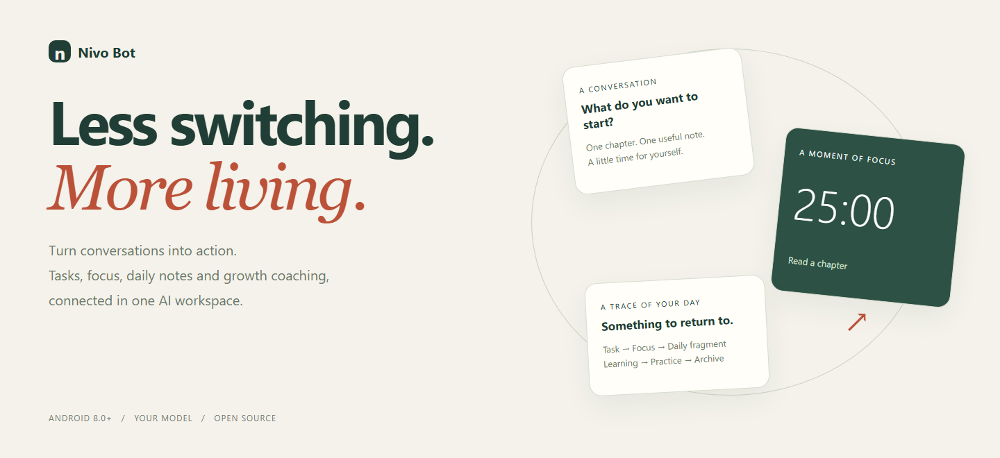
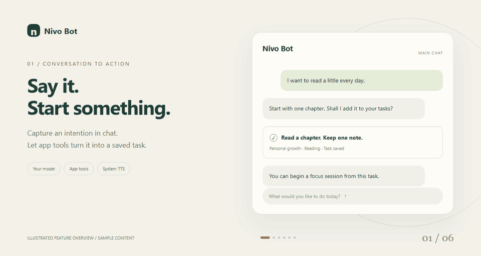
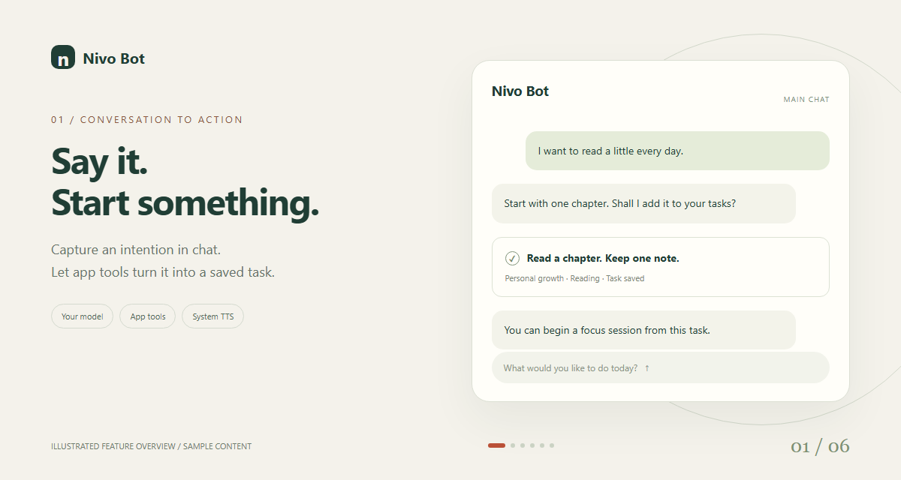
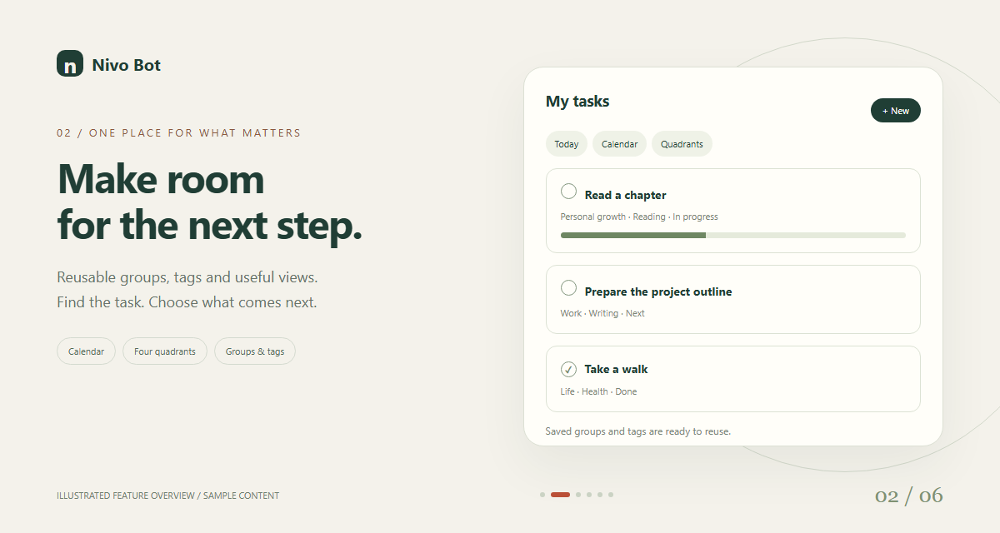
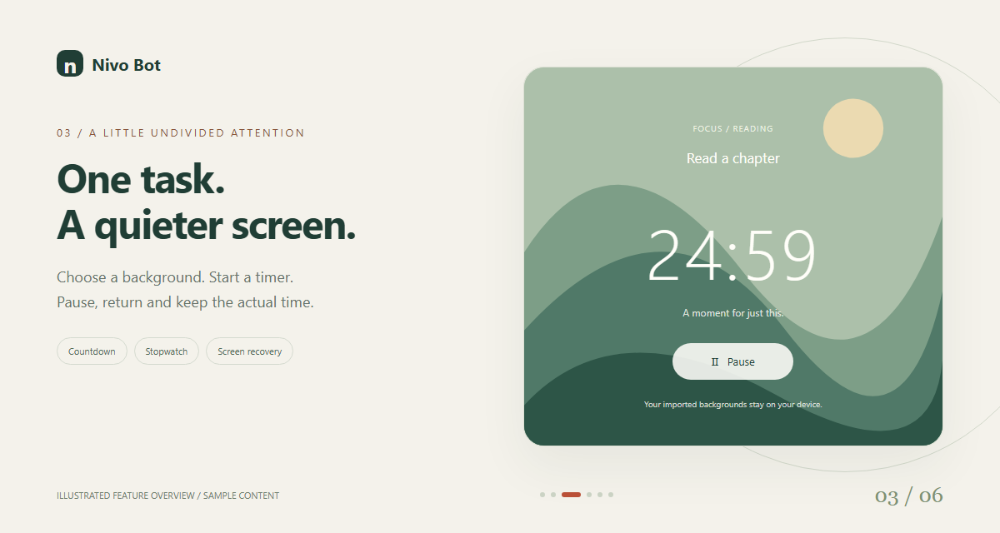
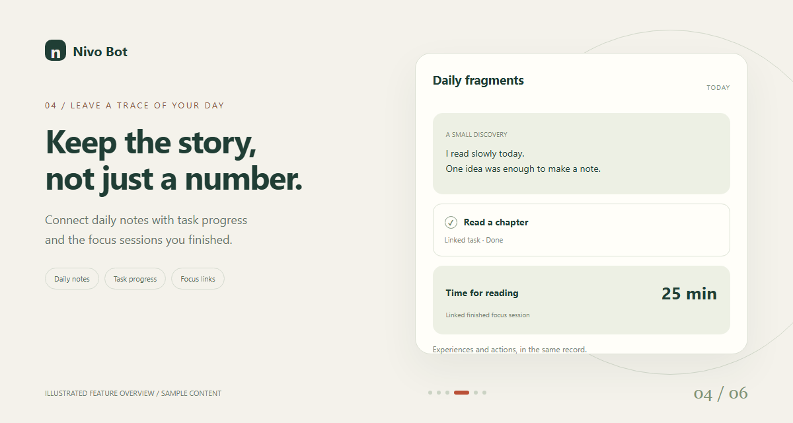
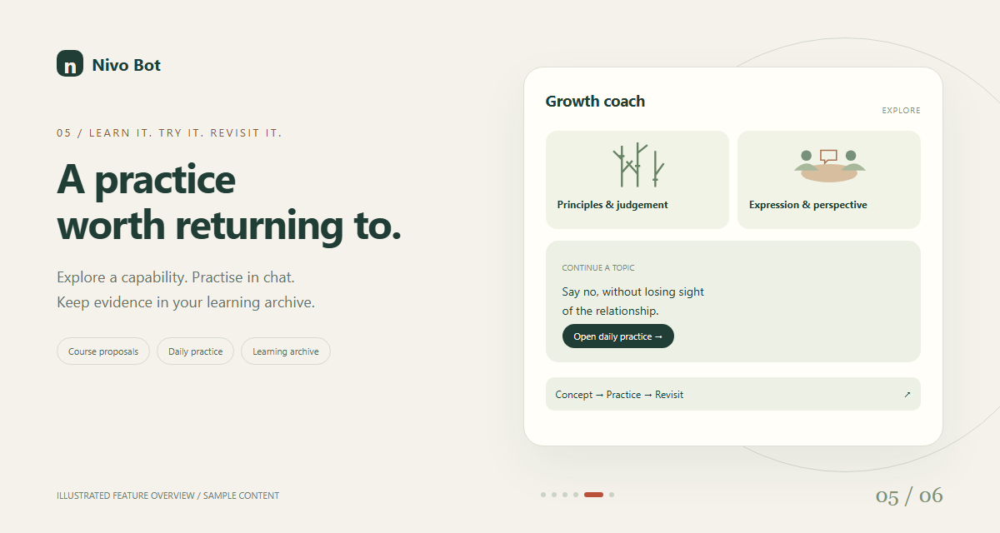
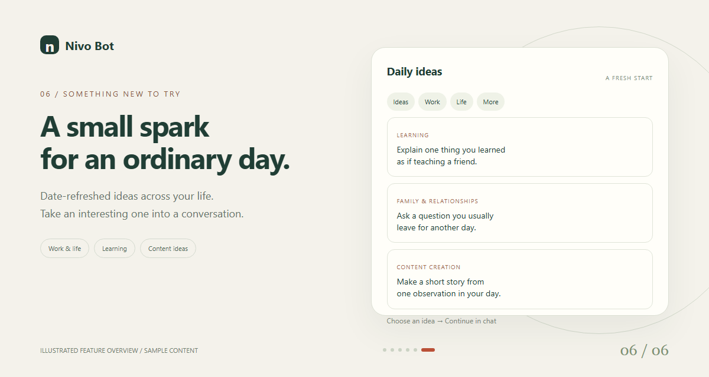

# Nivo Bot

<p align="center">
  <a href="https://nivo.8666886.xyz/"></a>
</p>

**Chat con IA, tareas, concentración, notas diarias y formación personal en Android e iOS.**

<p align="center">
  <a href="../../README.md">English</a> |
  <a href="README_zh.md">简体中文</a> |
  <a href="README_zh-TW.md">繁體中文</a> |
  <a href="README_es.md">Español</a> |
  <a href="README_fr.md">Français</a> |
  <a href="README_id.md">Bahasa Indonesia</a> |
  <a href="README_ja.md">日本語</a> |
  <a href="README_ko.md">한국어</a> |
  <a href="README_ru.md">Русский</a> |
  <a href="README_vi.md">Tiếng Việt</a>
</p>

<p align="center">
  <a href="../../LICENSE"></a>
  
  <a href="../releases/v2.0.7.md"></a>
  <br>
  <a href="https://nivo.8666886.xyz/">Sitio web</a> · <a href="https://github.com/sherlockerX/Nivo-Bot/issues">Problemas</a> · <a href="../../OPEN_SOURCE.md">Contribuir</a>
</p>

Nivo Bot es un espacio de trabajo con IA para la vida diaria. Empieza con una conversación, convierte el siguiente paso en una tarea, dedícale tiempo y guarda la experiencia para revisarla después.

Gratuito, de código abierto y sin ánimo de lucro. Elige tu proveedor de modelos; sus solicitudes pueden tener coste. La síntesis de voz Android lee respuestas con el motor del teléfono.

## Descubre Nivo

<p align="center">
  <a href="../media/readme/feature-tour.gif"></a>
</p>

Recorrido ilustrado con contenido de ejemplo. El GIF recorre horizontalmente seis módulos; pulsa una imagen fija para ampliarla. Son ilustraciones explicativas, no capturas de un teléfono.

<table>
<tr>
<td width="33%" align="center"><a href="../media/readme/chat.png"></a><br><sub>AI chat</sub></td>
<td width="33%" align="center"><a href="../media/readme/tasks.png"></a><br><sub>Tasks</sub></td>
<td width="33%" align="center"><a href="../media/readme/focus.png"></a><br><sub>Focus</sub></td>
</tr>
<tr>
<td width="33%" align="center"><a href="../media/readme/fragments.png"></a><br><sub>Daily fragments</sub></td>
<td width="33%" align="center"><a href="../media/readme/coach.png"></a><br><sub>Coach</sub></td>
<td width="33%" align="center"><a href="../media/readme/ideas.png"></a><br><sub>Daily ideas</sub></td>
</tr>
</table>

## Qué puedes hacer

| Área | Funciones de Android |
|---|---|
| Chat con IA | Configura proveedores, utiliza herramientas integradas de tareas y concentración y escucha las respuestas con la síntesis de voz del sistema Android. |
| Ideas | Consulta sugerencias que se renuevan según la fecha para trabajo, vida cotidiana, aprendizaje, familia y relaciones, creación de contenido y más. |
| Tareas | Reutiliza grupos y etiquetas guardados; alterna entre calendario, cuatro cuadrantes, grupos y estados; revisa la proporción de etiquetas de tareas completadas. |
| Concentración | Usa una cuenta atrás o un cronómetro, vincúlalo a una tarea, pausa y reanuda y abre un temporizador recuperable a pantalla completa con fondos importados localmente. |
| Notas diarias | Registra experiencias y adjunta el progreso de tareas o sesiones de concentración terminadas. |
| Coach | Explora capacidades, prepara propuestas de cursos mediante el chat con IA, practica en conversaciones de práctica diaria y revisa tu archivo de aprendizaje. |

Los gráficos cuentan tareas completadas por etiqueta, no tiempo invertido. Las estadísticas de concentración registran el tiempo real; terminar una sesión no completa automáticamente su tarea. Consultar un curso no lo marca como dominado.

## Una intención, un día conectado

Por ejemplo, quieres leer un poco cada día:

1. **Habla del objetivo.** Concreta la idea con IA y crea una tarea de lectura mediante las herramientas de la app.
2. **Dale un lugar.** Usa grupos y etiquetas guardados y encuentra la tarea en tu vista preferida.
3. **Dale tiempo.** Inicia una sesión vinculada a la tarea, elige un fondo y usa el temporizador a pantalla completa.
4. **Guarda la experiencia.** Vincula la sesión terminada y el progreso a una nota diaria con tus observaciones.
5. **Sigue aprendiendo.** Prepara un curso en el chat, practica en las conversaciones diarias y vuelve al archivo del Coach.

La conexión es la característica: la misma intención continúa entre conversación, acción, tiempo y reflexión.

La IA guarda los cambios mediante las herramientas de la aplicación. Una respuesta de chat no equivale a una tarea guardada; completar una tarea mediante IA requiere el informe explícito del usuario actual. El tiempo procede del temporizador, no de cifras inventadas por el modelo.

El aprendizaje, las tareas, la concentración y las notas usan almacenamiento local con reglas de cuenta y copia de seguridad propias de cada módulo. Tu proveedor procesa los mensajes enviados al modelo. Revisa permisos y cobertura de las copias antes de migrar de dispositivo.

## Primeros pasos

| Recurso | Enlace |
|---|---|
| Sitio del producto | [nivo.8666886.xyz](https://nivo.8666886.xyz/) |
| Android 8.0 o posterior, arm64 | [APK de Nivo Bot v2.0.7](https://nivo.8666886.xyz/downloads/Nivo-Bot-v2.0.7-arm64.apk) |
| iOS 16 o posterior, requiere firma personal | [IPA sin firmar v2.0.8 (Release)](https://nivo.8666886.xyz/downloads/Nivo-Bot-v2.0.8-unsigned.ipa) |
| Código fuente correspondiente al APK | [Paquete de código v2.0.7](https://nivo.8666886.xyz/downloads/Nivo-Bot-v2.0.7-source.zip) |
| Código fuente correspondiente al IPA de iOS | [Paquete de código iOS v2.0.8](https://nivo.8666886.xyz/downloads/Nivo-Bot-v2.0.8-source.zip) |
| Sumas de verificación | [SHA256SUMS-v2.0.7.txt](https://nivo.8666886.xyz/downloads/SHA256SUMS-v2.0.7.txt) |
| Sumas de verificación de iOS | [SHA256SUMS-v2.0.8.txt](https://nivo.8666886.xyz/downloads/SHA256SUMS-v2.0.8.txt) |
| Detalles de la versión | [Android2.0.7](../releases/v2.0.7.md) · [iOS2.0.8](../releases/v2.0.8.md) · [Android CI](https://github.com/sherlockerX/Nivo-Bot/actions/workflows/android.yml) · [iOS CI](https://github.com/sherlockerX/Nivo-Bot/actions/workflows/ios-check.yml) |

iOS2.0.8(59) Clarity se compiló como IPA sin firmar con configuración Release. La CI terminó correctamente y el IPA y su archivo de código fuente superaron la verificación local. Android conserva 2.0.7(58), con el mismo APK, código fuente, sumas de verificación e identidad de firma. El usuario no encontró problemas al comprobar la rama de auditoría en un iPhone; esto no valida el nuevo binario Release 2.0.8. Usa los enlaces anteriores de código fuente y sumas de verificación para cada plataforma. Se requiere una firma personal antes de instalarlo. Este fork no tiene cuenta del Apple Developer Program ni distribución por TestFlight o App Store. La concentración forzada, los planes de bloqueo recurrentes y las listas de aplicaciones permitidas son exclusivos de Android; iOS ofrece recordatorios e instrucciones de Acceso guiado, que el usuario inicia y termina en iOS. La compilación en CI no verifica el funcionamiento en un iPhone.

El ID de aplicación sigue siendo `io.github.nanomuse.app`, con la misma identidad de firma de las versiones oficiales anteriores de Nivo Bot. No se ha probado la actualización sobre una instalación existente en un teléfono Android físico para esta versión. Normalmente esta versión no puede actualizar instalaciones firmadas con una clave Debug antigua o del proyecto original. Comprueba las copias de seguridad y la restauración antes de desinstalar; consulta la [guía de versiones y firma](../android-development.md#nivo-bot的android版本与签名).

El archivo de código de Android se exporta desde el commit fijo utilizado para compilarlo. El catálogo de descargas registra ese commit y la suma de verificación del archivo; usa el código correspondiente a la versión instalada para revisarla o recompilarla.

## Compilar desde el código fuente

<details>
<summary>Detalles de desarrollo</summary>

Clona también los submódulos de dependencias nativas:

```bash
git clone --recurse-submodules https://github.com/sherlockerX/Nivo-Bot.git
cd Nivo-Bot
```

Utiliza JDK 21, Android SDK 36, NDK 27.2.12479018 y CMake 3.22.1. Se incluye Gradle Wrapper 8.11.1. Configura las herramientas y prepara las dependencias nativas en Linux o WSL:

```bash
bash scripts/android/build-natives.sh
```

En Windows PowerShell 7:

```powershell
$env:JAVA_HOME = 'C:\path\to\jdk21'
$env:ANDROID_HOME = 'C:\path\to\android-sdk'
./scripts/android/Build-Android.ps1 -Target Check
./scripts/android/Build-Android.ps1 -Target Debug
```

La [guía de desarrollo Android](../android-development.md) explica entradas nativas, pruebas, resultados y firma. Guarda claves y credenciales fuera del repositorio. Una compilación con caché no demuestra una compilación en un equipo limpio ni compatibilidad en dispositivos reales.

</details>

## Estructura del repositorio

<details>
<summary>Estructura del código</summary>

| Ruta | Contenido |
|---|---|
| `android/src/android/` | Aplicación Android; las ampliaciones de Nivo están en `io.github.nanomuse.*`. |
| `android/src/ios/` | Aplicación iOS nativa; entrega sin firmar mediante CI para firma personal. |
| `site/` | Sitio estático del producto y metadatos de descarga. |
| `docs/` | Guías, mapa del código y registros de versiones. |
| `scripts/android/`, `scripts/release/` | Herramientas de compilación, firma, auditoría y empaquetado del código. |
| `harness/`, `nanomuse/`, `cloud/`, `web/` | Código conservado de escritorio, runtime, relay y consola web, con ámbitos de publicación y verificación independientes. |

El árbol Android mantiene la estructura, los identificadores de paquetes y la atribución originales. Lee el [mapa del código](../android-code-map.md) antes de cambiar los límites de los módulos.

</details>

## Documentación

- [Entrada de código abierto y alcance de las contribuciones](../../OPEN_SOURCE.md)
- [Guía de uso Android](../zh/android.md)
- [Desarrollo Android y firma](../android-development.md)
- [Mapa del código Android](../android-code-map.md)
- [Concentración, Coach y compilación para iPhone](../ios-focus-and-coach.md)
- [Código del sitio y despliegue](../../site/README.md)
- [Registro de cambios](../../CHANGELOG.md)
- [Copyright y procedencia](../../NOTICE) · [Avisos de terceros](../../THIRD_PARTY_NOTICES.md)

## Contribuir

Comunica problemas reproducibles en las [Issues de este repositorio](https://github.com/sherlockerX/Nivo-Bot/issues) y envía PR con un alcance concreto. Sigue [OPEN_SOURCE.md](../../OPEN_SOURCE.md) y [CONTRIBUTING.md](../../CONTRIBUTING.md), con Conventional Commits, pruebas apropiadas y una firma DCO mediante `git commit -s`.

Conserva los avisos de copyright y licencia originales. No incluyas claves API, material de firma ni registros personales en incidencias o commits. OpenMinis mantiene su propia política de contribución; este fork no la modifica.

## Mantenimiento

Este fork de Nivo Bot lo mantiene <a href="https://github.com/sherlockerX">sherlockerX</a>. Comunica aquí los problemas específicos de Nivo para que lleguen a su responsable.

## Licencia

[GPL-3.0-or-later](../../LICENSE), conservando la licencia original. Mantén los avisos de copyright y licencia y ofrece el código fuente correspondiente al distribuir binarios según la GPL. El software se ofrece sin garantía; [NOTICE](../../NOTICE) y [THIRD_PARTY_NOTICES.md](../../THIRD_PARTY_NOTICES.md) recogen las condiciones del proyecto original y las dependencias.

## Agradecimientos

Nivo Bot se basa en [nanoMuse](https://github.com/nano-muse/nanoMuse), cuya base de agente, integraciones y arquitectura hicieron posible este trabajo. Gracias a nanoMuse, a <a href="https://github.com/lgy0404">Guangyi Liu (lgy0404)</a> y a sus colaboradores. La base móvil procede de [OpenMinis](https://github.com/OpenMinis/OpenMinis).

La lista reconoce contribuciones históricas de nanoMuse. Los créditos y hitos están en [el archivo de procedencia](../archive/upstream-readme-es.md); las condiciones de dependencias siguen en [THIRD_PARTY_NOTICES.md](../../THIRD_PARTY_NOTICES.md). Nivo Bot se mantiene de forma independiente.

<details>
<summary>Contribuciones y procedencia</summary>

<!-- contributors:start -->
<p>
<a href="https://github.com/cutey-none"></a>
<a href="https://github.com/Mola-maker"></a>
<a href="https://github.com/wsvn53"></a>
<a href="https://github.com/jiangkaiqi2005"></a>
<a href="https://github.com/hobostay"></a>
<a href="https://github.com/fenghaofenghao-ctrl"></a>
<a href="https://github.com/Yicheng-1218"></a>
<a href="https://github.com/PovedaAqui"></a>
<a href="https://github.com/Longfellow1"></a>
<a href="https://github.com/Battleplus"></a>
<a href="https://github.com/Ichiro786"></a>
<a href="https://github.com/aliabbas6622"></a>
<a href="https://github.com/isHeSatoshi"></a>
<a href="https://github.com/henrikdukefoss"></a>
<a href="https://github.com/cypggs"></a>
</p>
<!-- contributors:end -->

</details>
