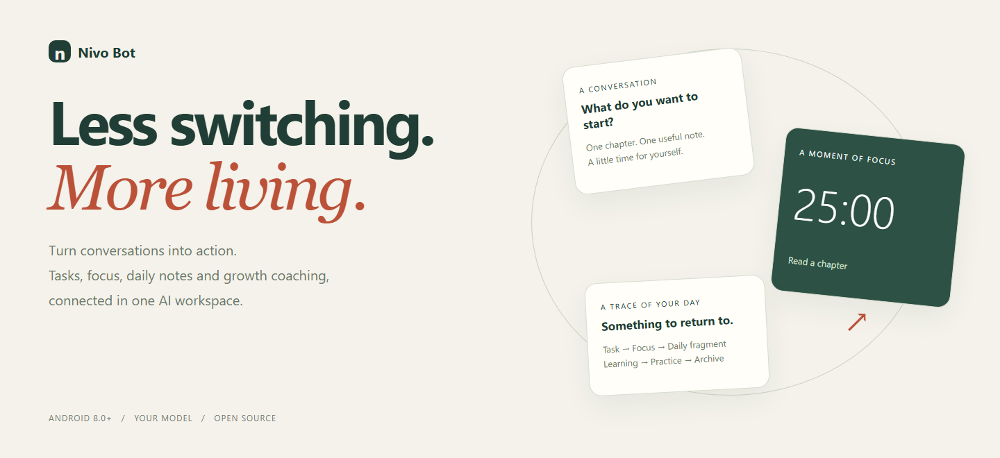
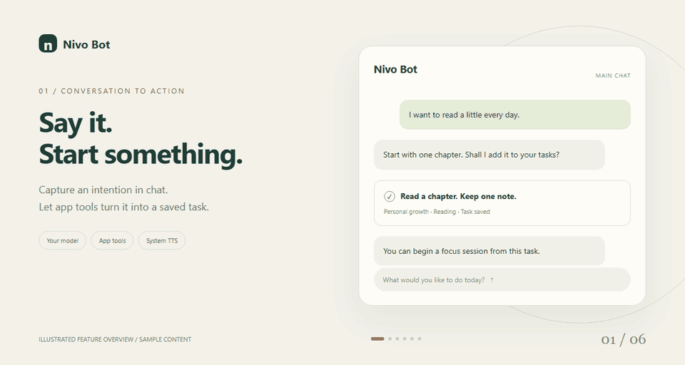
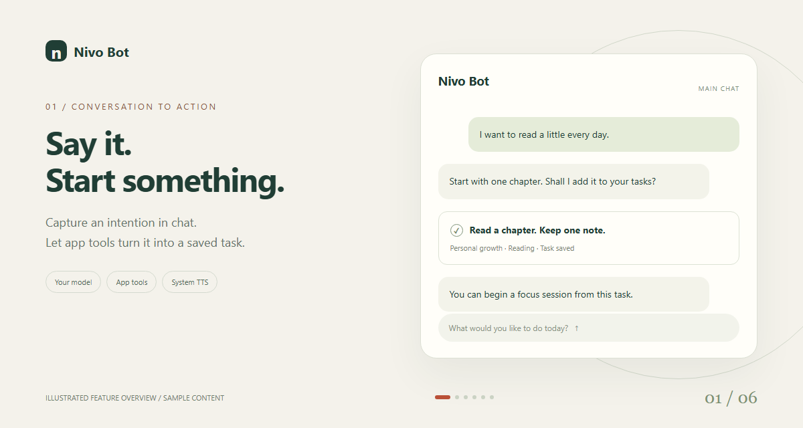
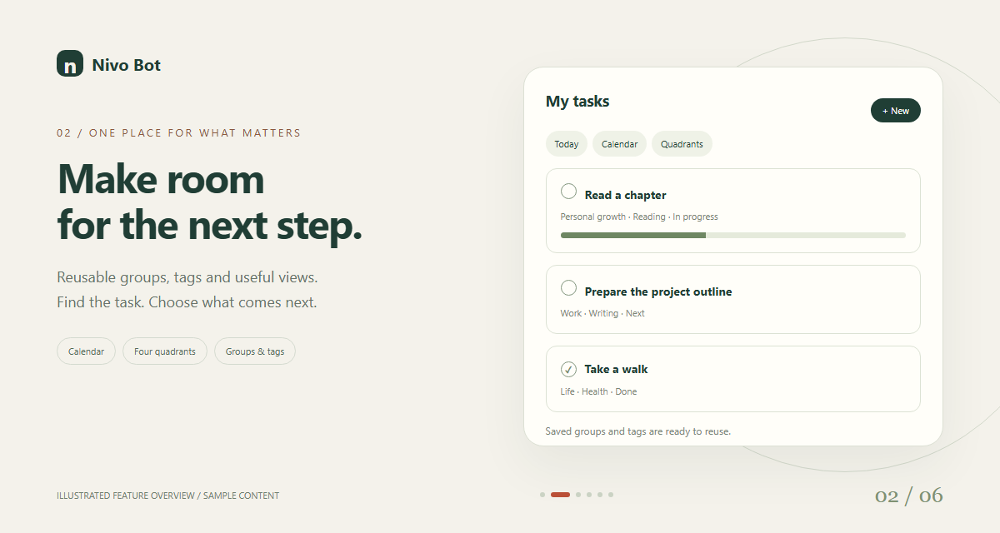
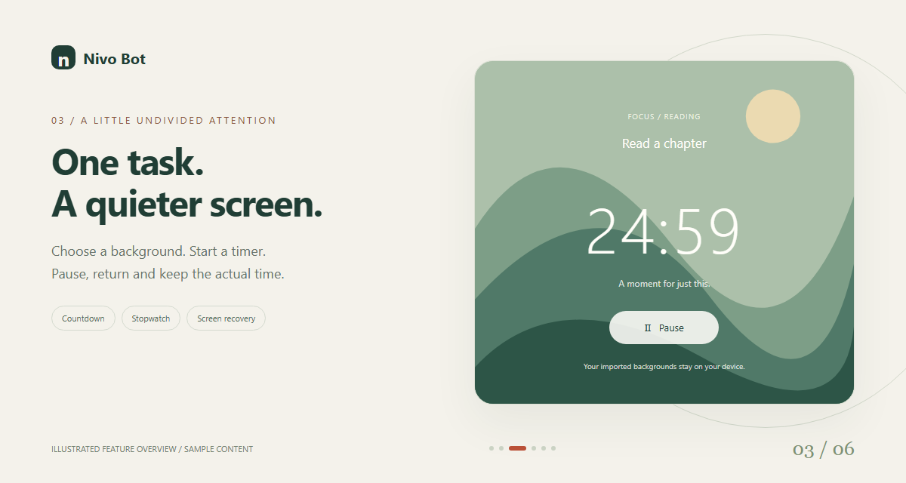
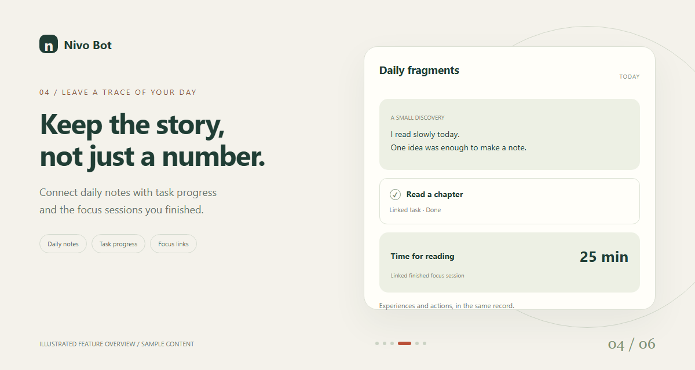
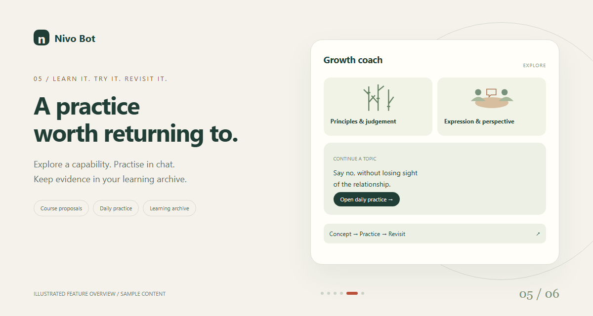
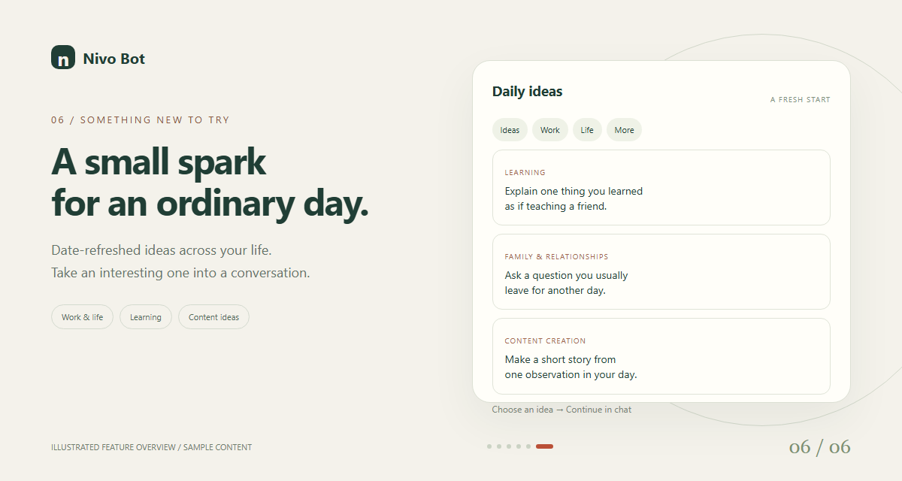

# Nivo Bot

<p align="center">
  <a href="https://nivo.8666886.xyz/"></a>
</p>

**Chat AI, tugas, fokus, catatan harian dan pelatihan pengembangan diri di Android dan iOS.**

<p align="center">
  <a href="../../README.md">English</a> |
  <a href="README_zh.md">简体中文</a> |
  <a href="README_zh-TW.md">繁體中文</a> |
  <a href="README_es.md">Español</a> |
  <a href="README_fr.md">Français</a> |
  <a href="README_id.md">Bahasa Indonesia</a> |
  <a href="README_ja.md">日本語</a> |
  <a href="README_ko.md">한국어</a> |
  <a href="README_ru.md">Русский</a> |
  <a href="README_vi.md">Tiếng Việt</a>
</p>

<p align="center">
  <a href="../../LICENSE"></a>
  
  <a href="../releases/v2.0.7.md"></a>
  <br>
  <a href="https://nivo.8666886.xyz/">Situs web</a> · <a href="https://github.com/sherlockerX/Nivo-Bot/issues">Laporan masalah</a> · <a href="../../OPEN_SOURCE.md">Berkontribusi</a>
</p>

Nivo Bot adalah ruang kerja AI untuk keseharian. Mulai dari percakapan, ubah langkah berikutnya menjadi tugas, berikan waktu fokus dan simpan pengalaman untuk ditinjau kembali.

Gratis, sumber terbuka dan nirlaba. Pilih penyedia model Anda; permintaannya mungkin berbayar. TTS Android membaca balasan dengan mesin suara ponsel.

## Jelajahi Nivo

<p align="center">
  <a href="../media/readme/feature-tour.gif"></a>
</p>

Tur ilustrasi dengan isi contoh. GIF bergeser horizontal melalui enam modul; klik gambar statis untuk memperbesar. Ini ilustrasi penjelasan, bukan tangkapan layar perangkat.

<table>
<tr>
<td width="33%" align="center"><a href="../media/readme/chat.png"></a><br><sub>AI chat</sub></td>
<td width="33%" align="center"><a href="../media/readme/tasks.png"></a><br><sub>Tasks</sub></td>
<td width="33%" align="center"><a href="../media/readme/focus.png"></a><br><sub>Focus</sub></td>
</tr>
<tr>
<td width="33%" align="center"><a href="../media/readme/fragments.png"></a><br><sub>Daily fragments</sub></td>
<td width="33%" align="center"><a href="../media/readme/coach.png"></a><br><sub>Coach</sub></td>
<td width="33%" align="center"><a href="../media/readme/ideas.png"></a><br><sub>Daily ideas</sub></td>
</tr>
</table>

## Yang dapat Anda lakukan

| Bagian | Fitur Android |
|---|---|
| Chat AI | Atur penyedia model, gunakan alat tugas dan fokus terintegrasi, serta dengarkan balasan dengan text-to-speech sistem Android. |
| Ide | Jelajahi saran yang diperbarui berdasarkan tanggal untuk pekerjaan, kehidupan, pembelajaran, keluarga dan hubungan, pembuatan konten dan lainnya. |
| Tugas | Gunakan kembali grup dan tag tersimpan; beralih antara kalender, empat kuadran, grup dan status; lihat proporsi tag tugas yang selesai. |
| Fokus | Jalankan hitung mundur atau stopwatch, hubungkan dengan tugas, jeda dan lanjutkan, serta gunakan timer layar penuh yang dapat dipulihkan dengan latar lokal. |
| Catatan harian | Catat pengalaman dan lampirkan kemajuan tugas atau sesi fokus yang sudah berakhir. |
| Coach | Jelajahi kemampuan, susun usulan kursus melalui chat AI, berlatih dalam percakapan latihan harian dan tinjau arsip pembelajaran. |

Grafik menghitung tugas selesai menurut tag, bukan waktu yang digunakan. Statistik fokus mencatat durasi nyata; mengakhiri sesi tidak otomatis menyelesaikan tugasnya. Membuka kursus tidak menandainya sebagai dikuasai.

## Satu niat, hari yang terhubung

Misalnya Anda ingin membaca sedikit setiap hari:

1. **Bicarakan tujuannya.** Perjelas dengan AI dan buat tugas membaca melalui alat aplikasi.
2. **Berikan tempat.** Gunakan grup dan tag tersimpan, lalu temukan tugas pada tampilan yang sesuai.
3. **Berikan waktu.** Mulai sesi terkait tugas, pilih latar dan buka timer layar penuh.
4. **Simpan pengalamannya.** Hubungkan sesi selesai dan kemajuan ke catatan harian beserta pengamatan Anda.
5. **Terus belajar.** Susun kursus lewat chat, berlatih dalam percakapan harian dan tinjau arsip Coach.

Keterhubungan adalah fiturnya: niat yang sama berlanjut dari percakapan ke tindakan, waktu dan refleksi.

AI menyimpan perubahan tugas melalui alat aplikasi. Balasan percakapan saja bukan tugas tersimpan; penyelesaian oleh AI memerlukan laporan eksplisit dari pengguna saat ini. Durasi fokus berasal dari timer, bukan angka buatan model.

Pembelajaran, tugas, fokus dan catatan memakai penyimpanan lokal dengan aturan akun dan pencadangan per modul. Pesan yang dikirim ke model diproses oleh penyedia pilihan Anda. Tinjau izin dan cakupan cadangan sebelum berpindah perangkat.

## Mulai menggunakan

| Sumber | Tautan |
|---|---|
| Situs produk | [nivo.8666886.xyz](https://nivo.8666886.xyz/) |
| Android 8.0 ke atas, arm64 | [APK Nivo Bot v2.0.7](https://nivo.8666886.xyz/downloads/Nivo-Bot-v2.0.7-arm64.apk) |
| iOS 16 ke atas, perlu penandatanganan pribadi | [IPA tanpa tanda tangan v2.0.8 (Release)](https://nivo.8666886.xyz/downloads/Nivo-Bot-v2.0.8-unsigned.ipa) |
| Sumber yang sesuai dengan APK | [Paket sumber v2.0.7](https://nivo.8666886.xyz/downloads/Nivo-Bot-v2.0.7-source.zip) |
| Sumber yang sesuai dengan IPA iOS | [Paket sumber iOS v2.0.8](https://nivo.8666886.xyz/downloads/Nivo-Bot-v2.0.8-source.zip) |
| Checksum unduhan | [SHA256SUMS-v2.0.7.txt](https://nivo.8666886.xyz/downloads/SHA256SUMS-v2.0.7.txt) |
| Checksum unduhan iOS | [SHA256SUMS-v2.0.8.txt](https://nivo.8666886.xyz/downloads/SHA256SUMS-v2.0.8.txt) |
| Detail rilis | [Android2.0.7](../releases/v2.0.7.md) · [iOS2.0.8](../releases/v2.0.8.md) · [Android CI](https://github.com/sherlockerX/Nivo-Bot/actions/workflows/android.yml) · [iOS CI](https://github.com/sherlockerX/Nivo-Bot/actions/workflows/ios-check.yml) |

iOS2.0.8(59) Clarity disiapkan sebagai IPA tanpa tanda tangan dengan konfigurasi Release; CI rilis dan verifikasi artefak masih menunggu. Unduhan Android tetap 2.0.7(58), dengan APK, arsip sumber, checksum dan identitas penandatanganan yang sama. Pengguna melaporkan tidak ada masalah saat memeriksa cabang audit di iPhone; laporan ini belum memvalidasi biner Release 2.0.8 yang baru. Tautan iOS di atas adalah alamat publikasi yang disiapkan. Penandatanganan pribadi diperlukan sebelum pemasangan. Fork ini tidak memiliki akun Apple Developer Program dan tidak menyediakan distribusi TestFlight atau App Store. Fokus paksa, jadwal penguncian berulang dan daftar aplikasi yang diizinkan hanya tersedia di Android; iOS menyediakan pengingat fokus dan petunjuk Akses Terpandu, yang dimulai dan diakhiri sendiri oleh pengguna di iOS. Kompilasi CI tidak membuktikan penerimaan saat dijalankan di iPhone.

ID aplikasi tetap `io.github.nanomuse.app`, dengan identitas penandatanganan resmi yang sama seperti rilis Nivo Bot sebelumnya. Pembaruan langsung di atas instalasi lama pada ponsel Android fisik belum diuji untuk rilis ini. Instalasi dengan kunci Debug lama atau kunci proyek hulu biasanya tidak dapat diperbarui dengan rilis ini. Periksa cakupan pencadangan dan pemulihan sebelum menghapus aplikasi; lihat [panduan versi dan penandatanganan](../android-development.md#nivo-bot的android版本与签名).

Arsip sumber Android diekspor dari commit tetap yang digunakan untuk build. Katalog unduhan mencatat commit tersebut dan checksum arsip; gunakan sumber untuk versi yang terpasang saat meninjau atau membangun ulang aplikasi.

## Membangun dari sumber

<details>
<summary>Detail pengembangan</summary>

Klon beserta submodul dependensi native:

```bash
git clone --recurse-submodules https://github.com/sherlockerX/Nivo-Bot.git
cd Nivo-Bot
```

Gunakan JDK 21, Android SDK 36, NDK 27.2.12479018 dan CMake 3.22.1. Gradle Wrapper 8.11.1 tersedia. Atur toolchain lalu siapkan dependensi native pada Linux atau WSL:

```bash
bash scripts/android/build-natives.sh
```

Pada Windows PowerShell 7:

```powershell
$env:JAVA_HOME = 'C:\path\to\jdk21'
$env:ANDROID_HOME = 'C:\path\to\android-sdk'
./scripts/android/Build-Android.ps1 -Target Check
./scripts/android/Build-Android.ps1 -Target Debug
```

Lihat [panduan pengembangan Android](../android-development.md) untuk input native, pengujian, keluaran dan tanda tangan rilis. Simpan kunci dan kredensial di luar repositori. Build dengan cache tidak membuktikan build pada mesin bersih atau kompatibilitas perangkat nyata.

</details>

## Struktur repositori

<details>
<summary>Struktur sumber</summary>

| Jalur | Isi |
|---|---|
| `android/src/android/` | Aplikasi Android; tambahan Nivo berada di `io.github.nanomuse.*`. |
| `android/src/ios/` | Aplikasi iOS native; hasil CI tanpa tanda tangan untuk penandatanganan pribadi. |
| `site/` | Situs produk statis dan metadata unduhan. |
| `docs/` | Panduan, peta sumber dan catatan rilis. |
| `scripts/android/`, `scripts/release/` | Alat build, penandatanganan, audit sumber dan pengemasan. |
| `harness/`, `nanomuse/`, `cloud/`, `web/` | Sumber desktop, runtime, relay dan konsol web yang dipertahankan, dengan cakupan rilis dan verifikasi terpisah. |

Pohon Android mempertahankan struktur, identitas paket dan atribusi hulu. Baca [peta sumber](../android-code-map.md) sebelum mengubah batas modul.

</details>

## Dokumentasi

- [Panduan sumber terbuka dan cakupan kontribusi](../../OPEN_SOURCE.md)
- [Panduan pengguna Android](../zh/android.md)
- [Pengembangan Android dan penandatanganan](../android-development.md)
- [Peta sumber Android](../android-code-map.md)
- [Fokus, Coach dan informasi build iPhone](../ios-focus-and-coach.md)
- [Sumber situs dan deployment](../../site/README.md)
- [Catatan perubahan](../../CHANGELOG.md)
- [Hak cipta dan asal-usul](../../NOTICE) · [Pemberitahuan pihak ketiga](../../THIRD_PARTY_NOTICES.md)

## Berkontribusi

Laporkan masalah yang dapat direproduksi melalui [Issues repositori ini](https://github.com/sherlockerX/Nivo-Bot/issues) dan kirim PR terarah. Ikuti [OPEN_SOURCE.md](../../OPEN_SOURCE.md) dan [CONTRIBUTING.md](../../CONTRIBUTING.md), termasuk Conventional Commits, pengujian sesuai perubahan dan sign-off DCO melalui `git commit -s`.

Pertahankan pemberitahuan hak cipta dan lisensi hulu. Jangan memasukkan kunci API, materi penandatanganan atau catatan pribadi ke issue dan commit. OpenMinis memiliki kebijakan kontribusinya sendiri; fork ini tidak mengubahnya.

## Pemelihara

Fork Nivo Bot ini dipelihara oleh <a href="https://github.com/sherlockerX">sherlockerX</a>. Laporkan masalah khusus Nivo di sini agar diterima pemelihara fork ini.

## Lisensi

[GPL-3.0-or-later](../../LICENSE), melanjutkan lisensi sumber terbuka asli. Pertahankan pemberitahuan dan sediakan sumber terkait ketika mendistribusikan biner sesuai GPL. Perangkat lunak diberikan tanpa jaminan; [NOTICE](../../NOTICE) dan [THIRD_PARTY_NOTICES.md](../../THIRD_PARTY_NOTICES.md) mencatat ketentuan hulu dan dependensi.

## Terima kasih

Nivo Bot dibangun di atas [nanoMuse](https://github.com/nano-muse/nanoMuse), dengan fondasi agen, integrasi dan arsitektur yang memungkinkan pekerjaan ini. Terima kasih kepada nanoMuse, <a href="https://github.com/lgy0404">Guangyi Liu (lgy0404)</a> dan kontributornya. Fondasi ponsel berasal dari [OpenMinis](https://github.com/OpenMinis/OpenMinis).

Daftar berikut mengakui kontribusi historis nanoMuse. Kredit dan tonggak ada di [arsip asal-usul](../archive/upstream-readme-id.md); ketentuan dependensi ada di [THIRD_PARTY_NOTICES.md](../../THIRD_PARTY_NOTICES.md). Nivo Bot dipelihara secara independen.

<details>
<summary>Kontributor dan asal-usul</summary>

<!-- contributors:start -->
<p>
<a href="https://github.com/cutey-none"></a>
<a href="https://github.com/Mola-maker"></a>
<a href="https://github.com/wsvn53"></a>
<a href="https://github.com/jiangkaiqi2005"></a>
<a href="https://github.com/hobostay"></a>
<a href="https://github.com/fenghaofenghao-ctrl"></a>
<a href="https://github.com/Yicheng-1218"></a>
<a href="https://github.com/PovedaAqui"></a>
<a href="https://github.com/Longfellow1"></a>
<a href="https://github.com/Battleplus"></a>
<a href="https://github.com/Ichiro786"></a>
<a href="https://github.com/aliabbas6622"></a>
<a href="https://github.com/isHeSatoshi"></a>
<a href="https://github.com/henrikdukefoss"></a>
<a href="https://github.com/cypggs"></a>
</p>
<!-- contributors:end -->

</details>
