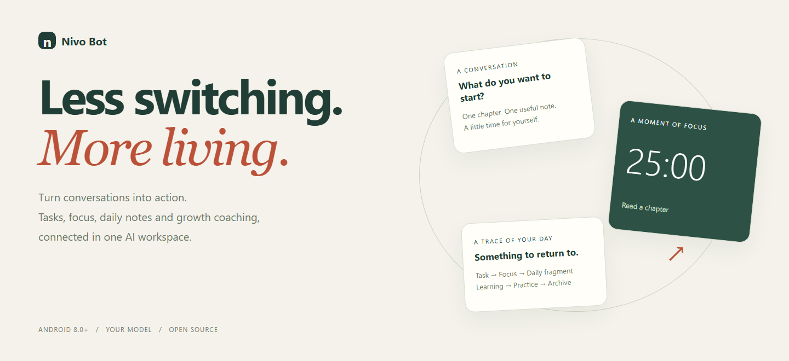
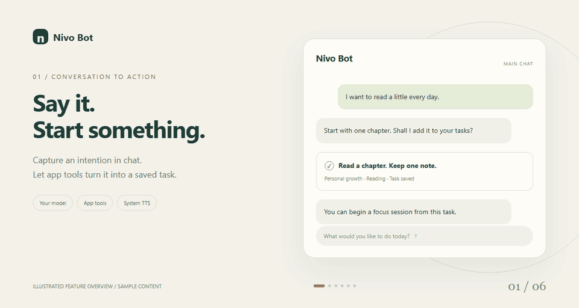
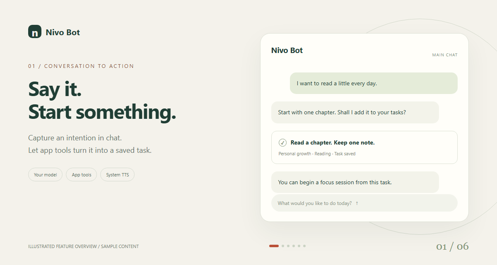
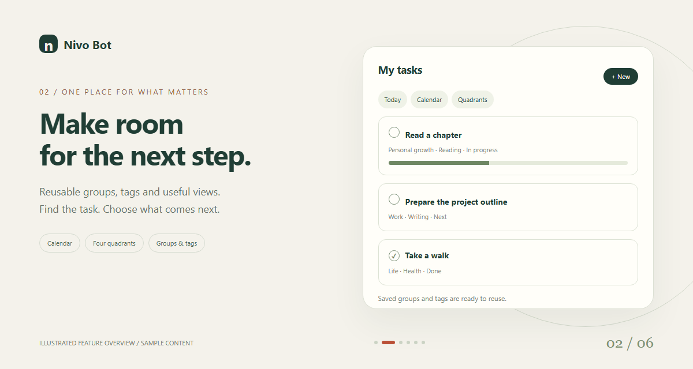
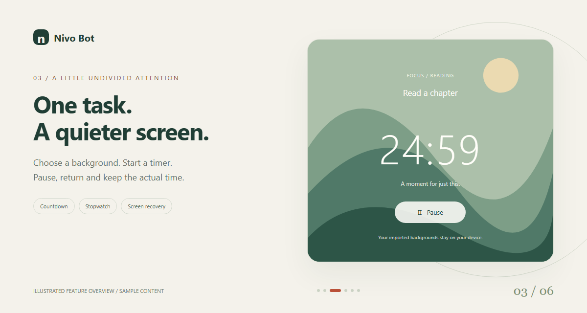
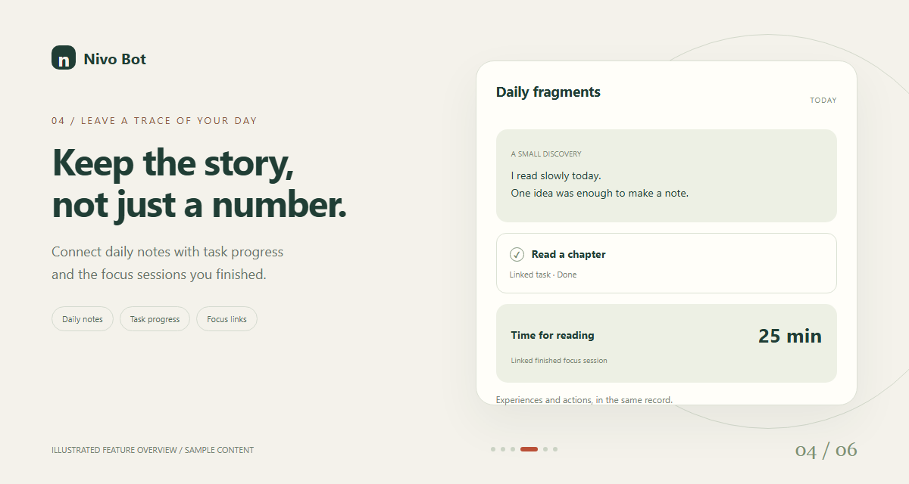
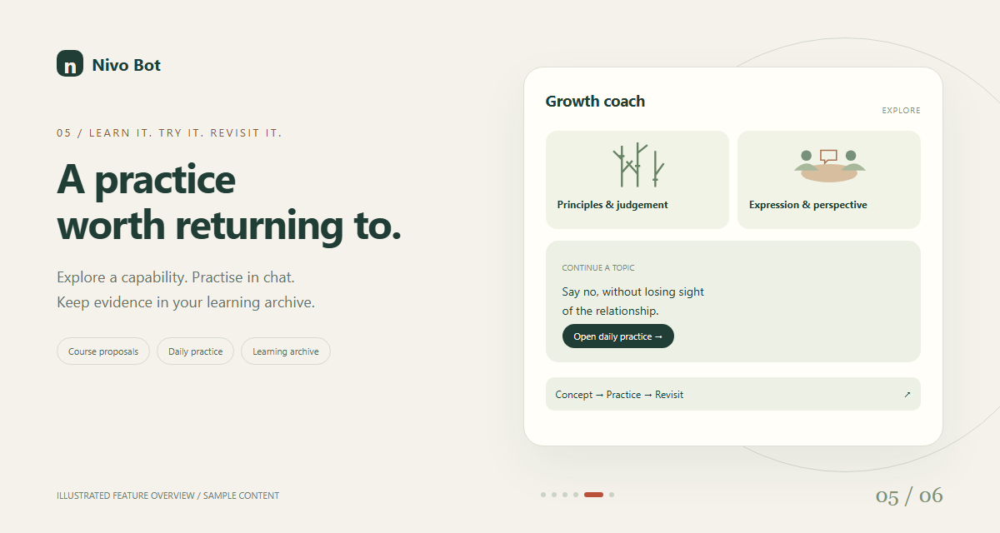
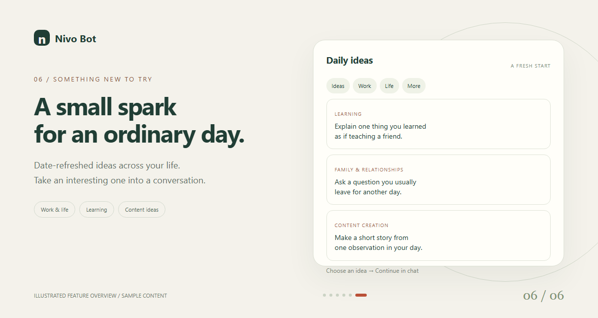

# Nivo

<p align="center">
  <a href="https://nivo.8666886.xyz/"></a>
</p>

<strong>AIチャット、タスク、集中、日々の記録と成長コーチをAndroidとiOSで。</strong>

<p align="center">
  <a href="../../README.md">English</a> |
  <a href="README_zh.md">简体中文</a> |
  <a href="README_zh-TW.md">繁體中文</a> |
  <a href="README_es.md">Español</a> |
  <a href="README_fr.md">Français</a> |
  <a href="README_id.md">Bahasa Indonesia</a> |
  <a href="README_ja.md">日本語</a> |
  <a href="README_ko.md">한국어</a> |
  <a href="README_ru.md">Русский</a> |
  <a href="README_vi.md">Tiếng Việt</a>
</p>

<p align="center">
  <a href="../../LICENSE"></a>
  
  <a href="../releases/v2.0.10.md"></a>
  <br>
  <a href="https://nivo.8666886.xyz/">製品サイト</a> · <a href="https://github.com/sherlockerX/Nivo-Bot/issues">問題報告</a> · <a href="../../OPEN_SOURCE.md">開発への参加</a>
</p>

Nivoは日常生活のためのAIワークスペースです。会話から始め、次の一歩をタスクにし、集中する時間を確保して、経験を振り返れる記録に残します。

無料・オープンソース・非営利。モデル提供元を自分で選び、リクエスト料金は提供元に従います。Android標準TTSで返信を読み上げます。

## Nivoを見てみる

<p align="center">
  <a href="../media/readme/feature-tour.gif"></a>
</p>

サンプル内容を使った機能説明図です。GIFが6つのモジュールを横に切り替えます。静止画はクリックして拡大できます。実機のスクリーンショットではありません。

<table>
<tr>
<td width="33%" align="center"><a href="../media/readme/chat.png"></a><br><sub>AI chat</sub></td>
<td width="33%" align="center"><a href="../media/readme/tasks.png"></a><br><sub>Tasks</sub></td>
<td width="33%" align="center"><a href="../media/readme/focus.png"></a><br><sub>Focus</sub></td>
</tr>
<tr>
<td width="33%" align="center"><a href="../media/readme/fragments.png"></a><br><sub>Daily fragments</sub></td>
<td width="33%" align="center"><a href="../media/readme/coach.png"></a><br><sub>Coach</sub></td>
<td width="33%" align="center"><a href="../media/readme/ideas.png"></a><br><sub>Daily ideas</sub></td>
</tr>
</table>

## できること

| 分野 | Androidの機能 |
|---|---|
| AIチャット | モデル提供元の設定、タスクと集中の統合ツール、Android標準TTSによる返信の読み上げ。 |
| アイデア | 仕事、生活、学習、家族と人間関係、コンテンツ制作などの日付に応じて更新される提案。 |
| タスク | 保存したグループとタグの再利用、カレンダー・4象限・グループ・状態表示の切り替え、完了タスクのタグ割合。 |
| 集中 | タスクに関連付けたカウントダウンやストップウォッチ、一時停止と再開、端末から取り込んだ背景を使う復元可能な全画面タイマー。 |
| 日々の記録 | 毎日の経験を記録し、タスクの進捗や終了した集中セッションを関連付ける。 |
| コーチ | 能力分野を探索し、AIチャットでコース案を作り、「毎日の練習」の会話で練習して学習記録を振り返る。 |

タスクのグラフはタグ別の完了件数を示し、所要時間ではありません。集中統計は実測時間を記録し、セッション終了でタスクが自動完了することはありません。コースを見るだけでは習得扱いになりません。

## 1つの思いから、つながる1日

例えば、毎日少しずつ本を読みたい場合：

1. <strong>話して具体化。</strong>AIと目標を整理し、アプリのツールで読書タスクを作ります。
2. <strong>置き場所を決める。</strong>保存したグループとタグを再利用し、好みの表示でタスクを探します。
3. <strong>時間を確保。</strong>タスクに関連付けて集中を開始し、背景を選んで全画面タイマーへ。
4. <strong>経験を残す。</strong>終了した集中と進捗を日々の記録に関連付け、気付きを残します。
5. <strong>学びを続ける。</strong>チャットでコース案を作り、毎日の練習を行ってコーチの記録を振り返ります。

つながりが特色です。同じ思いが会話、行動、時間、振り返りへと続きます。

AIはアプリのツールを通じてタスクの変更を保存します。会話の返信だけではタスクは保存されず、AIが完了させるには現在のユーザーによる明確な完了報告が必要です。集中時間はタイマーが計測し、モデルが作る数値ではありません。

学習、タスク、集中、日々の記録はローカル保存を使い、アカウントとバックアップの規則はモジュールごとに異なります。モデルへ送ったメッセージは設定した提供元が処理します。端末移行前に権限とバックアップ範囲を確認してください。

## はじめる

| リソース | リンク |
|---|---|
| 製品サイト | [nivo.8666886.xyz](https://nivo.8666886.xyz/) |
| Android8.0以上、arm64 | [Nivo v2.0.10 APK](https://nivo.8666886.xyz/downloads/Nivo-v2.0.10-arm64.apk) |
| iOS16以上、個人署名が必要 | [未署名IPA v2.0.10（Release）](https://nivo.8666886.xyz/downloads/Nivo-v2.0.10-unsigned.ipa) |
| Android・iOS共通ソース | [v2.0.10ソース一式](https://nivo.8666886.xyz/downloads/Nivo-v2.0.10-source.zip) |
| ダウンロードのチェックサム | [SHA256SUMS-v2.0.10.txt](https://nivo.8666886.xyz/downloads/SHA256SUMS-v2.0.10.txt) |
| リリース情報 | [Android2.0.10](../releases/v2.0.10.md) · [iOS2.0.10](../releases/v2.0.10.md) · [Android CI](https://github.com/sherlockerX/Nivo/actions/workflows/android.yml) · [iOS CI](https://github.com/sherlockerX/Nivo/actions/workflows/ios-check.yml) |

AndroidとiOSはどちらも2.0.10（61）です。Androidは従来のリリース証明書で署名しています。iOSのIPAはインストール前にご自身で署名してください。TestFlightやApp Storeでの配布はありません。

Androidの新しいパッケージ名は`io.github.nivo`です。旧版とは別にインストールされます。集中履歴、日々の記録、コーチの進捗は通常のバックアップでは移行できないため、旧版を残してください。

Androidのソースアーカイブは、ビルドに使用した固定コミットから書き出します。ダウンロード一覧にはそのコミットとアーカイブのチェックサムを記録します。確認や再ビルドには、インストールしたバージョンに対応するソースを使用してください。

## ソースからビルド

<details>
<summary>開発の詳細</summary>

ネイティブ依存関係のサブモジュールも取得します。

```bash
git clone --recurse-submodules https://github.com/sherlockerX/Nivo-Bot.git
cd Nivo-Bot
```

JDK21、Android SDK36、NDK27.2.12479018、CMake3.22.1を使用します。Gradle Wrapper8.11.1が含まれています。ツールを設定し、LinuxまたはWSLでネイティブ依存関係を準備します。

```bash
bash scripts/android/build-natives.sh
```

Windows PowerShell7の場合：

```powershell
$env:JAVA_HOME = 'C:\path\to\jdk21'
$env:ANDROID_HOME = 'C:\path\to\android-sdk'
./scripts/android/Build-Android.ps1 -Target Check
./scripts/android/Build-Android.ps1 -Target Debug
```

ネイティブ入力、テスト、出力、リリース署名は[Android開発ガイド](../android-development.md)を参照してください。署名鍵と認証情報はリポジトリ外に置きます。キャッシュを使ったビルド成功は、新規環境のビルドや実機互換性の検証ではありません。

</details>

## リポジトリ構成

<details>
<summary>ソース構成</summary>

| パス | 内容 |
|---|---|
| `android/src/android/` | Androidアプリ。Nivoの追加機能は`io.github.nanomuse.*`にあります。 |
| `android/src/ios/` | ネイティブiOSアプリ。個人署名向けにCIで未署名IPAを生成します。 |
| `site/` | 静的な製品サイトとダウンロード情報。 |
| `docs/` | ガイド、ソースマップとリリース記録。 |
| `scripts/android/`、`scripts/release/` | ビルド、署名、ソース監査とパッケージ作成ツール。 |
| `harness/`, `nanomuse/`, `cloud/`, `web/` | 保持されているデスクトップ、ランタイム、リレー、Webコンソールのソース。配布と検証の範囲はそれぞれ独立しています。 |

Androidツリーは上流の構造、パッケージIDと出典表示を保ちます。モジュール境界を変更する前に[ソースマップ](../android-code-map.md)を確認してください。

</details>

## ドキュメント

- [オープンソースと貢献の範囲](../../OPEN_SOURCE.md)
- [Android利用ガイド](../zh/android.md)
- [Android開発と署名](../android-development.md)
- [Androidソースマップ](../android-code-map.md)
- [iPhoneの集中、Coachとビルド情報](../ios-focus-and-coach.md)
- [サイトのソースと配備](../../site/README.md)
- [変更履歴](../../CHANGELOG.md)
- [著作権と出典](../../NOTICE)・[第三者の通知](../../THIRD_PARTY_NOTICES.md)

## 開発への参加

再現可能な問題は[このリポジトリのIssues](https://github.com/sherlockerX/Nivo-Bot/issues)へ報告し、範囲の明確なPRを送ってください。[OPEN_SOURCE.md](../../OPEN_SOURCE.md)と[CONTRIBUTING.md](../../CONTRIBUTING.md)に従い、Conventional Commits、変更に必要なテスト、`git commit -s`で付けるDCO署名を使います。

上流の著作権とライセンス表示を保持します。IssueやコミットにAPI鍵、署名情報、個人の記録を含めないでください。OpenMinisの貢献方針は独立しており、このフォークでの受付はその方針を変更しません。

## メンテナー

Nivoのこのフォークは<a href="https://github.com/sherlockerX">sherlockerX</a>が管理しています。Nivo固有の問題はここで報告してください。

## ライセンス

元の[GPL-3.0-or-later](../../LICENSE)を継承します。著作権とライセンス表示を保持し、バイナリ配布時にはGPLに従い対応ソースを提供してください。ソフトウェアは無保証です。上流と依存関係の条件は[NOTICE](../../NOTICE)と[THIRD_PARTY_NOTICES.md](../../THIRD_PARTY_NOTICES.md)に記録されています。

## 謝辞

Nivoは[nanoMuse](https://github.com/nano-muse/nanoMuse)を基にしています。エージェント基盤、統合、アーキテクチャを提供したnanoMuse、<a href="https://github.com/lgy0404">Guangyi Liu（lgy0404）</a>と貢献者の皆さんに感謝します。モバイル基盤は[OpenMinis](https://github.com/OpenMinis/OpenMinis)です。

下の名簿はnanoMuseの過去の貢献への謝辞です。全文と過去の節目は[出典アーカイブ](../archive/upstream-readme-ja.md)、依存関係の条件は[THIRD_PARTY_NOTICES.md](../../THIRD_PARTY_NOTICES.md)にあります。Nivoは独立して管理されています。

<details>
<summary>上流の貢献者と出典</summary>

<!-- contributors:start -->
<p>
<a href="https://github.com/cutey-none"></a>
<a href="https://github.com/Mola-maker"></a>
<a href="https://github.com/wsvn53"></a>
<a href="https://github.com/jiangkaiqi2005"></a>
<a href="https://github.com/hobostay"></a>
<a href="https://github.com/fenghaofenghao-ctrl"></a>
<a href="https://github.com/Yicheng-1218"></a>
<a href="https://github.com/PovedaAqui"></a>
<a href="https://github.com/Longfellow1"></a>
<a href="https://github.com/Battleplus"></a>
<a href="https://github.com/Ichiro786"></a>
<a href="https://github.com/aliabbas6622"></a>
<a href="https://github.com/isHeSatoshi"></a>
<a href="https://github.com/henrikdukefoss"></a>
<a href="https://github.com/cypggs"></a>
</p>
<!-- contributors:end -->

</details>
